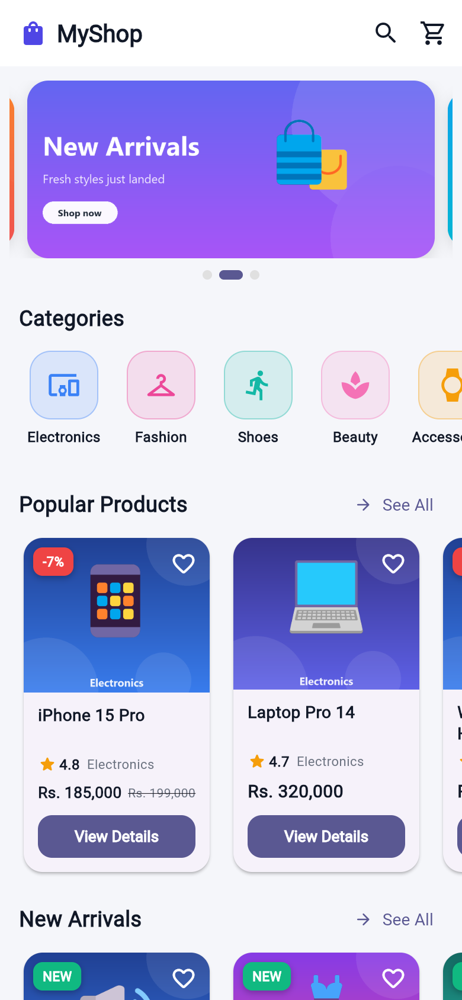
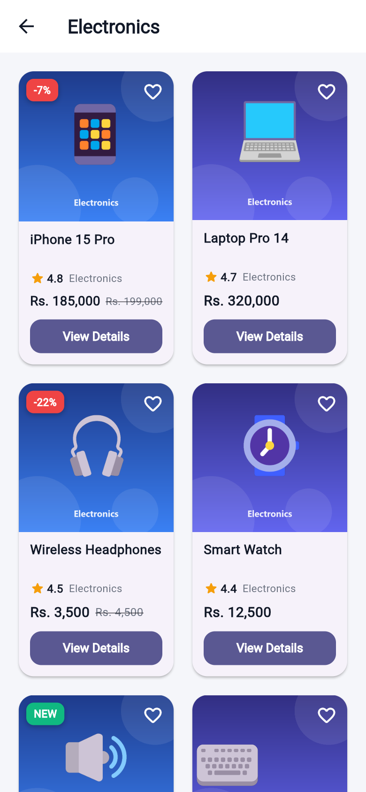
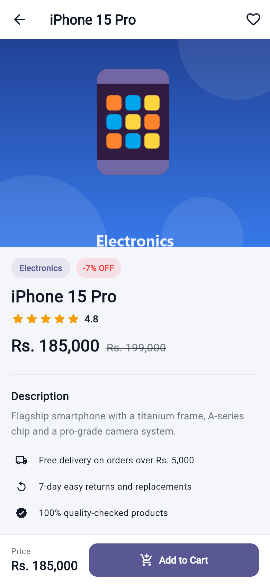

# MyShop – Mini E-Commerce Application

| | |
|---|---|
| **Project Name** | MyShop (Mini E-Commerce Application) |
| **Student Name** | Rohan Shrestha |
| **Student ID** | _\<YOUR STUDENT ID\>_ |
| **Course** | Mobile Application Development – Flutter |
| **Assignment** | Practical Assignment – Mini E-Commerce Application |

## Description

MyShop is a multi-screen mini e-commerce mobile application built with Flutter.
It shows products organised by categories and lets users navigate from the
home page to category pages and individual product-detail pages. All product
data is static/local – no backend, login, payment or database is required.

## Features

- **Home page** – AppBar with app logo, search and cart (with live badge);
  auto-playing promotional banner carousel; horizontally scrolling category
  list; "Popular Products" and "New Arrivals" sections with reusable product
  cards
- **Category page** – products of the selected category in a responsive
  `GridView.builder` (2 columns on phones, 3 on tablets)
- **Product details page** – product image, name, star rating, price
  (with discount badge), category chip, description and an **Add to Cart**
  button that shows a SnackBar and updates the cart badge
- **Reusable widgets** – `ProductCard`, `CategoryItem`, `BannerCarousel`
- **Search** – quick product search dialog from the AppBar
- **Cart sheet** – bottom sheet listing added items with total
- **Bonus** – Hero image animation, favourite toggles, sale/New badges,
  cart badge, responsive grid
- **Data** – 6 categories, 36 products, 3 promotional banners (local assets)
- Clean Material 3 UI, consistent spacing/colors, no overflow errors

## Screenshots

| Home Page | Category Page | Product Details |
|---|---|---|
|  |  |  |

## Packages Used

| Package | Version | Why |
|---|---|---|
| [carousel_slider](https://pub.dev/packages/carousel_slider) | ^5.1.2 | Auto-playing promotional banner carousel on the home page (resolved to the current compatible version on pub.dev) |

## Project Structure

```
lib/
├── main.dart
├── models/
│   └── product.dart          # Product model + price formatter
├── screens/
│   ├── home_page.dart        # Home: AppBar, carousel, categories, products
│   ├── category_page.dart    # GridView of products per category
│   └── product_details_page.dart
├── widgets/
│   ├── product_card.dart     # Reusable Card + Container + Stack product card
│   ├── category_item.dart    # Reusable category tile
│   └── banner_carousel.dart  # carousel_slider banner section
├── data/
│   ├── product_data.dart     # Static categories + 36 products
│   └── cart_controller.dart  # Simple in-memory cart (badge + SnackBar)
└── theme/
    └── app_theme.dart        # Colors + Material 3 theme
assets/
└── images/
    ├── banners/              # 3 promotional banners
    └── products/             # 36 product images
```

## How to Run

1. Make sure [Flutter](https://docs.flutter.dev/get-started/install) is installed (`flutter --version`).
2. Get the packages:

   ```bash
   flutter pub get
   ```

3. Run on a connected device, emulator or simulator:

   ```bash
   flutter run
   ```

4. (Optional) Run the tests:

   ```bash
   flutter test
   ```

## Flutter Concepts Demonstrated

- **Layout:** `Scaffold`, `AppBar`, `Container`, `Padding`, `SizedBox`, `Row`, `Column`, `Expanded`
- **Scrolling:** `SingleChildScrollView`/`ListView` (vertical), horizontal scrolling lists, `GridView.builder`
- **UI components:** `Card`, `Stack`, `Image`, `Icon`, `IconButton`, `ElevatedButton`, `TextButton`
- **Navigation:** `Navigator.push`, `MaterialPageRoute`, passing data between screens
- **Reusable components:** `ProductCard`, `CategoryItem`, carousel widget
- **External package:** `carousel_slider` from pub.dev, added via `pubspec.yaml`
